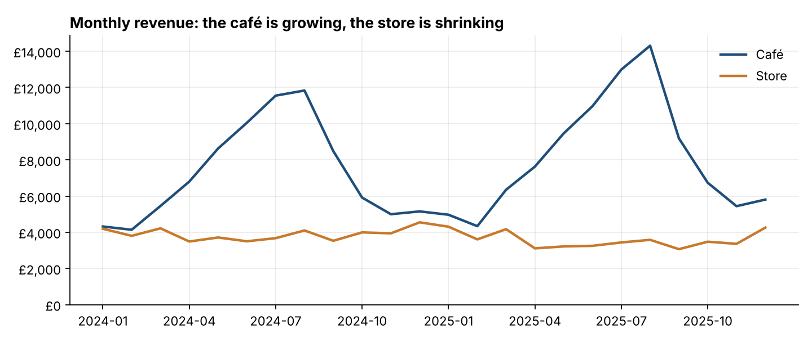
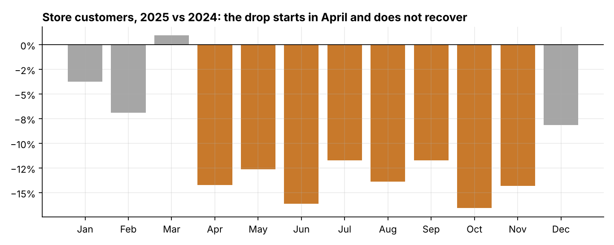
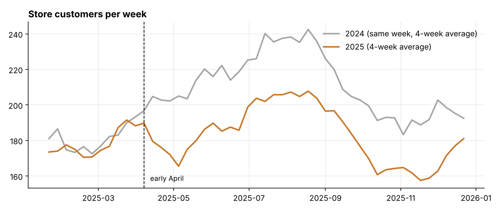
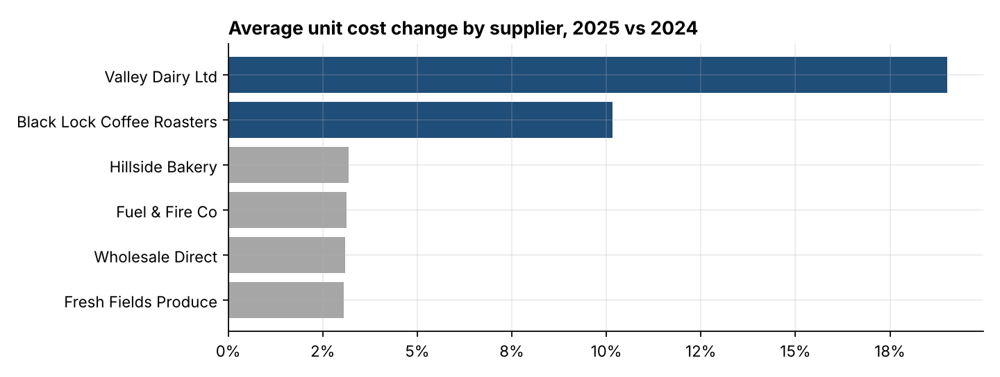
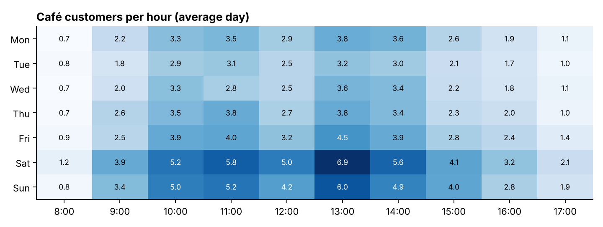
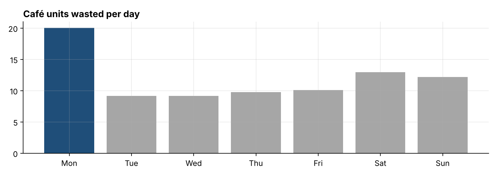

# The Towpath: café and store analysis

**Excel · Python (pandas) · SQL · Power BI**

The Towpath is a canalside café with a small convenience store attached. The owner, Gwen, had a feeling she could not put numbers on:

> "The café feels busy but the shop feels quiet. Am I imagining it, and what should I do about it?"

This project answers that question from two years of raw till, rota, supplier, wastage and weather data (1 Jan 2024 to 31 Dec 2025). I cleaned the raw export, modelled it as a star schema, and analysed it three ways (SQL, Python and Power BI). All three give the same numbers.

> The data is fictional. It was generated for training, with realistic data quality problems built in. The business, the people and the suppliers do not exist.

## The answer in one minute

| | 2024 | 2025 | Change |
|---|---:|---:|---:|
| Total revenue | £133,994 | £141,004 | **+5.2%** |
| Café revenue | £87,308 | £98,176 | **+12.4%** |
| Store revenue | £46,686 | £42,828 | **−8.3%** |
| Store customers | 10,617 | 9,453 | **−11.0%** |
| Gross margin | 67.2% | 66.9% | −0.2 pts |

Gwen is right. The business grew overall, but the total hides two opposite stories: the café is growing fast and the store is losing customers.



## Findings

### 1. The store lost its customers in April 2025, and price was not the reason

Store customers were close to the previous year from January to March 2025 (−3.0%). From April to December they were 13.2% lower, and they were down every single month.



The obvious suspect was the price rise, so I checked the timing. All 20 store products were repriced once, in January 2025, by about 3.5%. Customers kept coming for three more months and only dropped in April. The customers who still come spend slightly more per visit (£4.40 to £4.53). So price does not explain it.



A sudden, lasting drop in footfall that starts in one week points to something outside the till data, most likely a competitor opening nearby. The data cannot prove that, so it is a question for Gwen and not a conclusion.

### 2. Two suppliers are squeezing margin

Four suppliers raised unit costs by about 3%, in line with the price rise. Valley Dairy went up 19% and the coffee roaster 10%. Shelf prices did not follow.

| Category | Margin 2024 | Margin 2025 |
|---|---:|---:|
| Store dairy | 35.8% | 25.6% |
| Café cold treats (ice cream) | 81.7% | 77.8% |
| Café hot drinks | 81.4% | 78.2% |

Hot drinks are the café's biggest category (£34,674 in 2025), so three points of margin there matters.



### 3. Saturday is understaffed, Tuesday and Wednesday are overstaffed

Saturday is the busiest café day (about 43 customers) but has only 16 staff hours, the same as a quiet Monday. Tuesday and Wednesday are the quietest days and have 24 staff hours each.

| Day | Customers per day | Staff hours | Customers per staff hour |
|---|---:|---:|---:|
| Tuesday | 22.0 | 24 | 0.92 |
| Wednesday | 23.3 | 24 | 0.97 |
| **Saturday** | **42.9** | **16** | **2.68** |



### 4. The café wastes twice as much on a Monday

Monday café waste is 2.1 times the Tuesday to Friday average (20 units a day against about 9.5). Almost all of it is unsold fresh food: tuna sandwiches, croissants, scones, brownies and Welsh cakes. Monday has far fewer customers than the weekend, so the Monday prep looks like it is still sized for weekend trade.



### 5. Sun only matters in summer

Season drives café revenue more than weather does. A summer day takes two to three times a winter day. Weather makes a real difference only in summer, when a sunny day brings in about £458 against £317 on a day of heavy rain. In winter the takings are about the same whatever the weather.

### 6. A negative result worth reporting

I ran a basket analysis to look for products that sell together. The most common pairs are just the best sellers (two coffees in one order), and every lift value is below 1. There is no hidden cross-sell pattern, so there is no evidence to support a meal deal.

## Recommendations for Gwen

1. **Find out what changed near the store in early April 2025.** If a competitor opened, compare its range and prices before changing anything else. The categories that fell most since April are fruit and veg, fuel, drinks, bakery and dairy.
2. **Renegotiate or re-tender the dairy contract, and review hot drink and dairy shelf prices.** Costs went up 19% and prices about 3%.
3. **Move one café shift from Tuesday or Wednesday to Saturday.** This costs nothing extra in wages.
4. **Cut the Monday order for the five most-wasted fresh products.** Bringing Monday down to the Tuesday to Friday level would save about £375 a year at cost price.
5. **Staff and bake up for sunny summer forecasts.** Do not adjust for weather in winter.

## How the project is built

```
Raw export (8 messy sheets)
        │   python/01_clean_data.py          every fix counted in a cleaning log
        ▼
Clean star schema workbook  ──────────────►  Power BI dashboard (39 DAX measures, 4 pages)
        │
        ├──►  sql/                           schema, 6 quality checks, 11 business queries (SQLite)
        ├──►  sql/mysql/                     the same analysis as one MySQL 8 script
        └──►  python/02_towpath_analysis.ipynb   the full investigation with charts
```

### Folder guide

| Path | What it is |
|---|---|
| `data/raw/towpath_raw_data.xlsx` | The raw export: 77,778 sales lines plus products, suppliers, purchases, staff, shifts, wastage and weather |
| `data/clean/towpath_powerbi_data.xlsx` | The cleaned star schema that Power BI reads, including the Date table and a Cleaning_Log sheet |
| `python/01_clean_data.py` | Rebuilds the clean workbook from the raw file. `--check` compares the rebuild with the saved workbook |
| `python/02_towpath_analysis.ipynb` | The analysis notebook with all outputs and charts |
| `python/03_run_sql.py` | Loads the clean data into SQLite and runs every query in `sql/` |
| `sql/` | Star schema, data quality checks and business questions (JOINs, CTEs, conditional aggregation, RANK, LAG, running totals) |
| `sql/mysql/` | MySQL 8 version: one script that creates the database, loads the CSVs and runs 17 analysis queries |
| `data/clean/csv/` | The clean tables as CSV files, for loading into MySQL |
| `powerbi/` | Data model, the 39 DAX measures and the report pages |
| `outputs/` | Charts, SQL results and `key_numbers.csv` |
| `docs/` | Data dictionary and the cleaning log |

### Data cleaning

The raw export had the problems real operational data has. Each one was fixed in code and logged.

| Problem found | Fix | Rows |
|---|---|---:|
| Exact duplicate sales lines | Removed | 922 |
| Missing unit prices | Filled with that product's median price in the same month | 614 |
| Sales with no staff member | Set to "Unknown" and added an Unknown staff row, so no sales are lost in joins | 768 |
| Quantities of 120 to 200 on one till line | Flagged "Suspicious", kept in the data, excluded from measures | 6 |
| Dates typed as text in two formats | Converted to real dates | 4,634 |
| Prices typed as text with a £ sign | Converted to numbers | 309 |
| `Cafe`, `cafe`, `CAFE`, `Shop`, `store` | Standardised to Café and Store | all |
| Payment method in 13 spellings | Trimmed and standardised to Card, Cash, Contactless | all |
| Two product names that did not match their ID | Corrected (P005 Pot of Tea, P016 Chocolate Brownie) | 2 |
| Impossible weather readings (99.9°C, −40°C, negative rain) | Set to blank | 3 |
| Days missing from the weather feed | Added, so the Date table has every day | 12 |

The full list is in [docs/cleaning_log.md](docs/cleaning_log.md).

Two decisions are worth explaining:

- **Suspicious lines are flagged, not deleted.** Deleting data hides the problem. Flagging keeps the evidence and lets every measure choose to exclude it. Including them would overstate two-year revenue by £2,166.
- **Each sale carries the cost paid at that week's delivery**, not today's cost price. That is why the margin squeeze from the dairy supplier shows up at all. With a single current cost price, 2024 margin would look the same as 2025.

### One version of the truth

The same business rules are written three times, in DAX, SQL and pandas, and they return the same numbers.

| Check (2025) | Power BI | SQL | Python |
|---|---:|---:|---:|
| Total revenue | £141,004 | 141,003.50 | 141,003.50 |
| Revenue vs last year | +5.2% | +5.2% | +5.23% |
| Gross margin | 66.9% | 66.9% | 66.94% |

The rules:

- **Revenue** = quantity × unit price, excluding Suspicious lines. Refunds count as negatives.
- **Customers** = distinct receipts with at least one normal Sale line.
- **Gross margin** = (revenue − quantity × unit cost) ÷ revenue.
- **Waste cost** = units wasted × product cost price.

## Run it yourself

```bash
pip install -r requirements.txt

python python/01_clean_data.py --check    # rebuild the clean data and compare with the saved workbook
python python/03_run_sql.py               # run all SQL, writes outputs/sql_results.md
jupyter notebook python/02_towpath_analysis.ipynb
```

For MySQL, see [sql/mysql/README.md](sql/mysql/README.md). For Power BI, see [powerbi/README.md](powerbi/README.md).

## What I would do next

- Ask Gwen what happened locally in April 2025, then test the competitor idea with data (for example, whether the lost visits were at particular times of day).
- Forecast daily café demand from season, weekday and weather, to set the bake and the rota.
- Add wage cost to the dashboard to show profit after staffing, not just gross margin.

## About me

**Bhavan Chandupatla**, Data Analyst. MSc Data Science (Merit), Coventry University.

[bhavananalyst.com](https://bhavananalyst.com) · [GitHub](https://github.com/bhavanchandupatla123)
